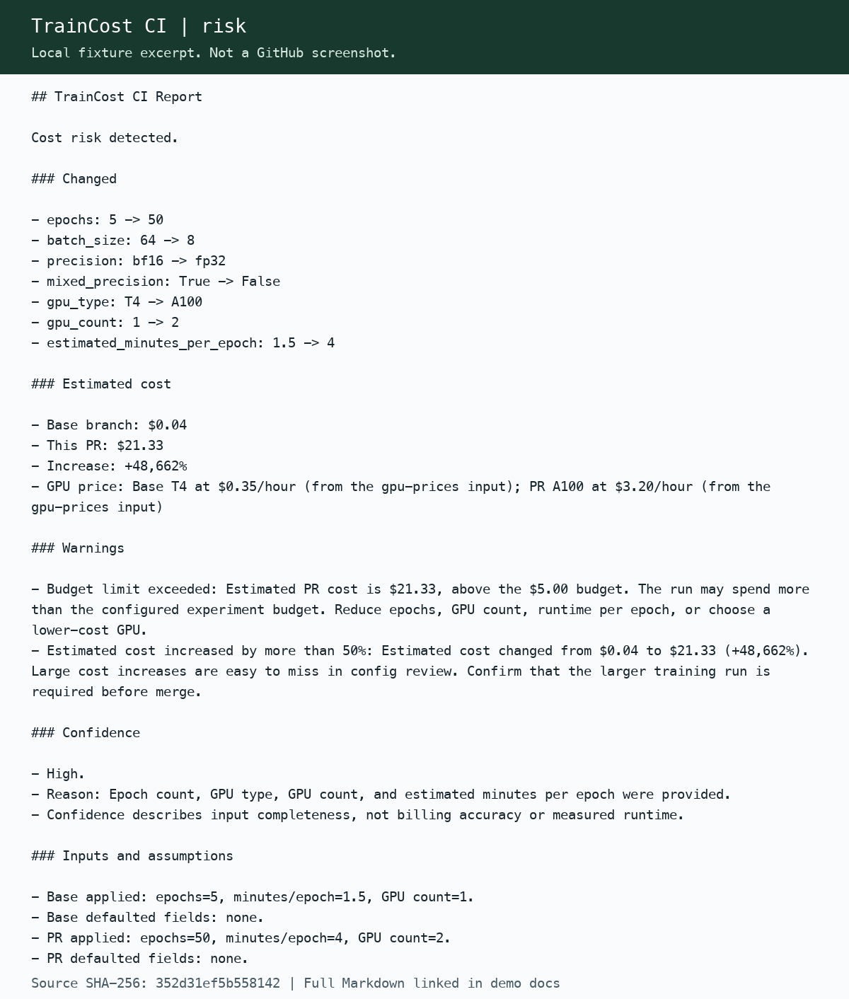

# TrainCost CI

Review ML training cost risk before a pull request is merged.
TrainCost CI compares training configs, estimates GPU-hours and cost, and explains its inputs and assumptions.
Think **Infracost for ML experiments**.

**Status: v0.2.0-beta.1 candidate, not published.** The existing v0.1.0 tag does not include these safeguards.
This beta focuses on reports and GitHub Step Summary. PR commenting is experimental.

## See the three outcomes

| Scenario | Result | Evidence |
| --- | --- | --- |
| More epochs, larger GPUs, less efficient settings | $0.04 to $21.33, +48,662%, risk warnings | [Full report](examples/pytorch-demo/expected-report.md) |
| GPU and runtime information missing | Low confidence, explicit assumed inputs | [Full report](examples/pytorch-demo/expected-missing-report.md) |
| Invalid epoch count | No estimated cost, error status, exit 2 | [Full report](examples/pytorch-demo/expected-invalid-report.md) |

These are deterministic config examples, not measured training runs.
[All report images and reproduction steps](docs/demo_script.md) cover the three scenarios.

## Run locally

Python 3.11 or later is required. From the repository root:

~~~bash
python3 -m venv .venv
.venv/bin/python -m pip install -r requirements-dev.txt
.venv/bin/python scripts/verify_release.py
.venv/bin/python packages/github-action/traincost_action.py \
  --base-config examples/pytorch-demo/configs/base-config.yaml \
  --head-config examples/pytorch-demo/configs/risky-config.yaml \
  --gpu-prices "T4=0.35,A10G=1.2,A100=3.20" \
  --budget-limit 5 --comment-mode false --report-path report.md
~~~

Analysis runs locally. It does not execute training code or send config contents to an external service.
Dependency installation downloads PyYAML; experimental comment mode sends the sanitized report to GitHub.

## Use in GitHub Actions

This example runs the action from this repository. External consumers must pin the reviewed candidate SHA listed in the [QA report](docs/qa_report.md).
The candidate tag does not exist until publication is approved.

~~~yaml
name: Review training cost
on: pull_request
permissions:
  contents: read
jobs:
  traincost:
    runs-on: ubuntu-latest
    steps:
      - uses: actions/checkout@34e114876b0b11c390a56381ad16ebd13914f8d5 # v4.3.1
        with:
          fetch-depth: 0
          persist-credentials: false
      - uses: ./
        id: cost
        with:
          config-path: "examples/pytorch-demo/config.yaml"
          gpu-prices: "T4=0.35,A100=3.20"
          budget-limit: "5"
          comment-mode: "false"
~~~

The action writes report-path, comment-posted, and analysis-status outputs, and appends the report to Step Summary.
Cost risk does not fail the job. Invalid inputs or an entirely failed analysis return exit 2.
[Full input, output, and status reference](docs/github_action_usage.md).

## What is detected

TrainCost reads these exact keys from YAML, JSON, and literal Python assignments:

model, model_name, epochs, max_epochs, batch_size, global_batch_size, precision, mixed_precision,
gpu_type, gpu_count, estimated_minutes_per_epoch, dataset_size, budget_limit_usd.

Nested canonical keys are supported with source paths. Conflicting values and training fields inside lists are rejected.
It does not infer GPU hardware from the runner, execute Python expressions, resolve Hydra, or translate framework-specific aliases.
[Supported formats and validation rules](docs/config_reference.md).

## What the estimate means

~~~text
GPU-hours = epochs * estimated_minutes_per_epoch / 60 * gpu_count
cost = GPU-hours * hourly_price
~~~

Use your provider's rate per GPU-hour through gpu-prices. Built-in prices are illustrative examples, not current market rates.
Missing fields use visible defaults and Low confidence. An unknown GPU price uses $1/GPU-hour and Medium confidence.
Confidence describes input completeness, not actual billing accuracy.
Runtime is held fixed when GPU count changes; multi-GPU speedups, utilization, storage, and network charges are not modeled.
Combined totals cover analyzed configs, not a forecast that every config will be run.

## Engineering evidence

- [Architecture and trust boundaries](docs/architecture.md)
- [Regression tests and release gates](docs/testing_strategy.md)
- [Current QA evidence](docs/qa_report.md)
- [Portfolio walkthrough](docs/portfolio.md)
- [PM status and remaining publication steps](docs/pm_status.md)
- [Beta release notes](docs/release_notes_v0.2.0.md)

MIT licensed. No dashboard, backend, cloud account, or paid GPU is required.
