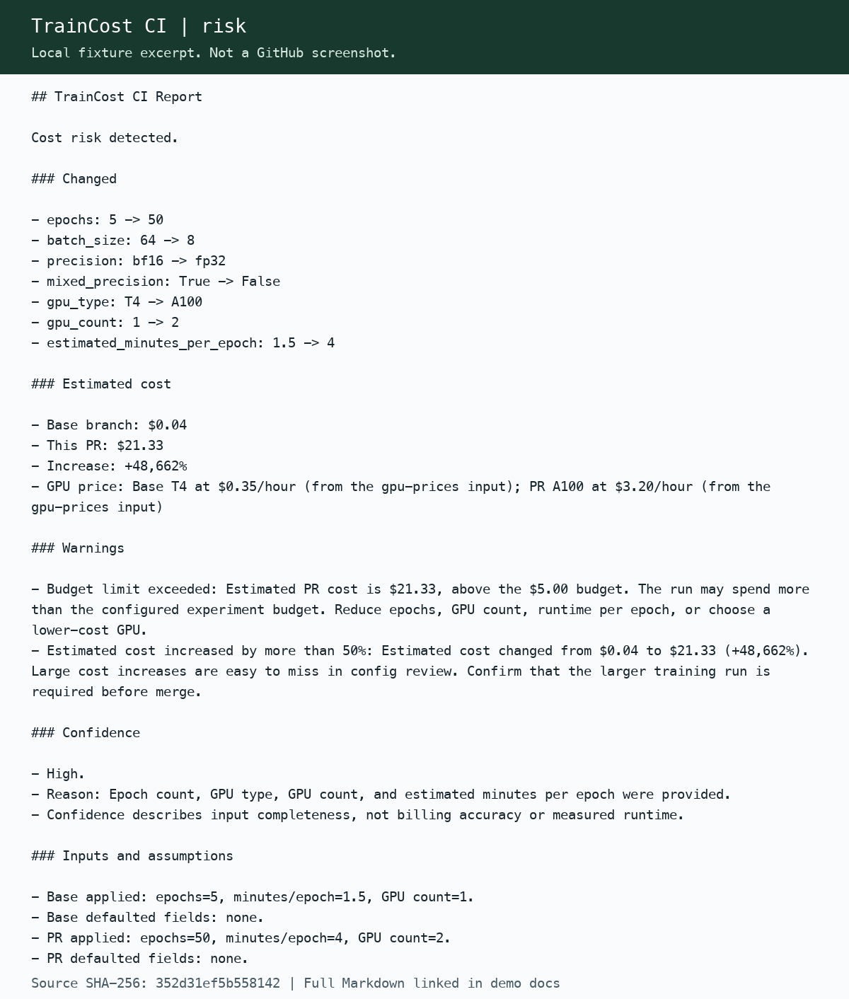
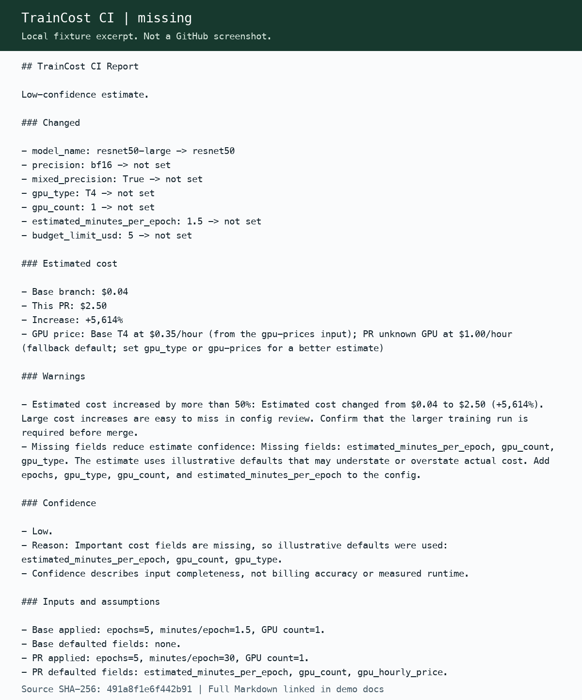
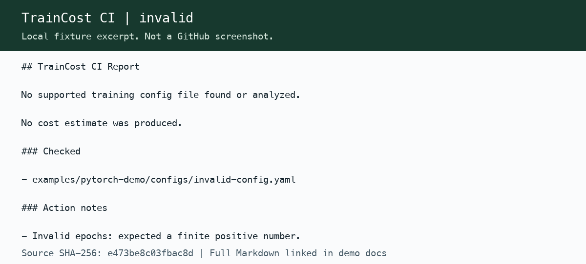

# Demonstrate three report outcomes

Install requirements-dev.txt in a Python 3.11+ venv. Run all examples from the repository root.
No training, GPU, or GitHub token is required.

~~~bash
.venv/bin/python scripts/verify_release.py
~~~

The verifier checks root/package metadata and all three fixtures byte-for-byte.

## 1. Risk detected

Compare configs/base-config.yaml with configs/risky-config.yaml using the command in README.md.
The report shows $0.04, $21.33, +48,662%, and all demo warnings.
These rates are explicit illustrative inputs, not market quotes.

## 2. Information missing

Use configs/missing-config.yaml as --head-config with the same base and price inputs.
Expect analysis-status=complete, exit 0, Low confidence, and explicit defaulted fields.
Complete means the input was processed, not that the estimate is accurate.

## 3. Invalid input

Use configs/invalid-config.yaml as --head-config.
Expect analysis-status=error, exit 2, no cost estimate, and a value-free epoch validation diagnostic.

## GitHub evidence

For a live demo PR, change `examples/pytorch-demo/config.yaml`. The standalone
example workflow uses `config.yaml` at the root of its consumer repository.
Use the candidate SHA and run links in docs/qa_report.md.
Do not merge risky demo changes into main. Keep the canonical config as the cheap baseline.
Local images above are rendered from actual fixture text and labeled as excerpts.
